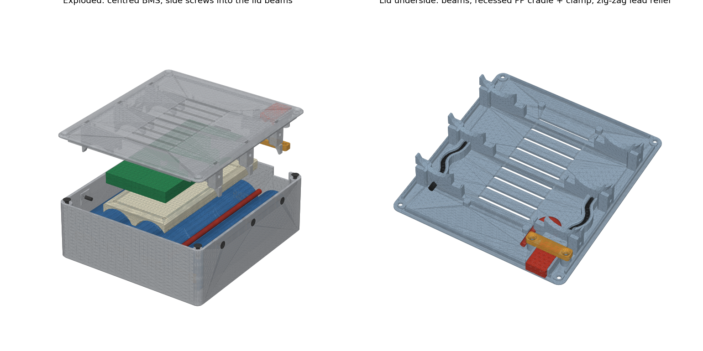
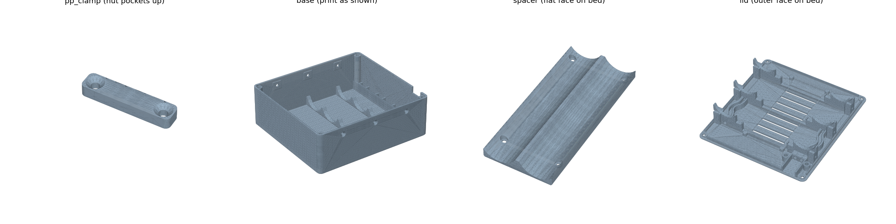
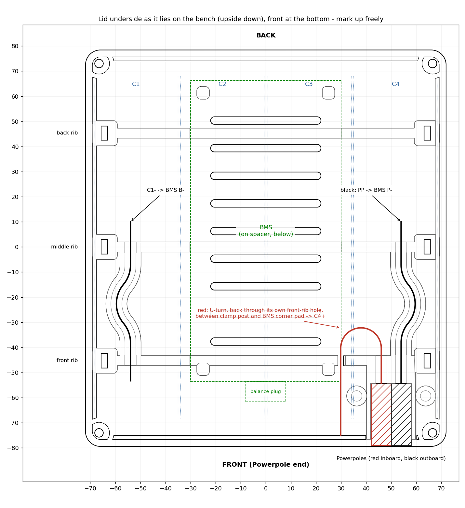
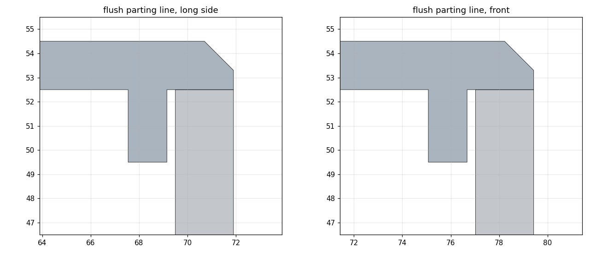
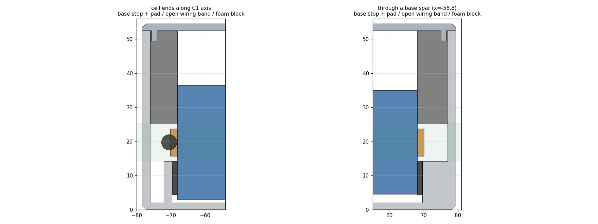

# bat706: 4S LiFePO4 battery pack for the Icom IC-706MKII

A portable 13.x V supply for an Icom IC-706MKII:
- **Cells:** 4 × 3.2 V 15 Ah LiFePO4 laser-welded cylindrical cells in 4S (Ø33.5 × 136.25 mm, with 20 × 8 × 2 mm copper solder tabs).
- **BMS:** a 3S–20S 30 A balancing BMS (60 × 120 × 10 mm).
- **Output:** an Anderson Powerpole pair.
- **Rating:** **12.8 V nominal, 14.6 V full, 15 Ah, ~192 Wh.**

The case is **143.8 W × 157.9 L × 54.5 H mm**, inside the radio's own 167 × 200 × 58 mm footprint. It's 3D-printed without supports.



## 3D viewer

**<https://poynting.github.io/bat706/>**

It shows the printed parts with the dummy cells, BMS, Powerpoles, leads, screws, nuts and foam, so you can check fit as well as look at the parts. The viewer offers:
- **Parts:** toggle each part, solo it, or show only the printed parts.
- **Explode:** a slider that spreads the assembly apart.
- **Section cut:** slice along X, Y or Z.
- **Views:** iso, top, front, side and under.
- **X-ray lid:** see inside with the lid on.
- **Live dimensions:** the size of whatever is visible.

The same page is in the repo as [`viewer/index.html`](viewer/index.html). It's self-contained, but it needs internet once to load three.js. GitHub Actions (`.github/workflows/pages.yml`) republishes the committed file on every push to `main`. CI only copies the file, so rebuild it locally before you push (see [Regenerating](#regenerating)).

## Schematic


- **Connections:** charger and radio both connect to the Powerpoles (common-port BMS).
- **Switching:** the BMS switches the negative side, so never connect a load between P+ and B−.
- **Balance plug:** fit it last, after checking the voltage steps on its pins: 0, 3.2, 6.4, 9.6, 12.8 V.

## Layout


The cells alternate direction. Seen from the **front** (Powerpole end), the ends are C1 −, C2 +, C3 −, C4 +. Pack B− is C1− and pack B+ is C4+, both at the front. The series links are:
- **Back:** C1+→C2− and C3+→C4−.
- **Front:** C2+→C3−.

## Design




### Cells and BMS
- **Base:** a tub with three cradle saddles under the cells.
- **Spacer:** a printed block shaped to the tops of C2 and C3. It carries the BMS, centred across the case.
- **BMS position:** the BMS sits 3 mm from the spacer's **back** end. Its balance connector is on the front edge, so this leaves room at the Powerpole end for the plug and leads.
- **BMS mounting:**
  - **Boards:** the BMS is two boards on corner standoffs, heat-sink board toward the lid.
  - **Screws:** the lower board's own corner screws come out. 4 × M3×5 ISO 7380 button heads replace them, going up through counterbored pockets in the spacer and the lower board into the standoff threads.
  - **Pockets:** each is deep enough for the head to clear the cell's curved top.
  - **Location:** the screws locate the BMS, so the lid needs no fences around it.
- **Cell clamping:**
  - **Seats:** every seat sits 0.5 mm off the cell, with 1 mm foam tape in the gap. That covers the base saddles, the spacer and the lid ribs.
  - **Lid pressure:** the lid's 4 corner pads sit over the BMS standoffs and press the BMS onto the spacer, and the spacer onto C2/C3. The lid ribs press C1 and C4.
- **Cell ends:**
  - **Bottom third:** a rigid 2.4 mm base end stop, braced by 2 mm floor spars to the end wall, with a 2–3 mm closed-cell foam pad on its face (1.5 mm gap).
  - **Middle third:** fully open for the tabs and the 12 AWG links.
  - **Top third:** a closed-cell foam block you cut to fit, pressed in by the lid.
  - **Bays:** 5 mm at the front and 4 mm at the back. That's enough because the string is wired on the bench before it goes in.

### Lid
- **Beams:** three wall-to-wall beams at the saddle stations. Each beam is three pieces joined into one:
  - a rib clamping C1;
  - a 3 mm ridge crossing over the BMS;
  - a rib clamping C4.

  The ribs also act as the BMS side fences. The ridges are inside the lid rather than on top, because the lid prints outer face down. Each beam end takes a side screw.
- **Valley channels:** each rib has a slot over the C1/C2 and C3/C4 valleys. These are free for balance leads.
- **Vents:** slots over the BMS.

### Powerpoles
- **Placement:** a red/black pair in the front-right corner, hanging in a lid cradle. Red is inboard ("red right, tongue top" seen from the mating face) and black is toward the wall.
- **Recessed:** the mating face sits 0.5 mm inside the front wall's outer face, so nothing sticks out to be knocked off. The mating plug goes into the wall notch, which has a 0.6 mm 45° lead-in.
- **Backstop:** a solid backstop fills the space from the housings to the front beam and takes the push when you plug in. Its underside stays 0.5 mm clear of the clamp bar, so the bar always clamps the housings.
- **Clamp bar:** a printed bar under the housings screws up into the lid, with the screws hidden.

### Wiring through the lid



This is the lid as it lies upside down on the bench. There's a printable PDF to mark up: `cad/out/lid_routing.pdf`.

- **Black output (outboard, over C4):**
  - **Out of the lid:** straight back from its Powerpole through a 4.6 mm teardrop hole in the backstop and front beam.
  - **Zig-zag:** a snap-in zig-zag channel takes it to a hole in the middle beam, then it goes on to BMS P−.
- **Red output (inboard):**
  - **Out of the lid:** straight back through its own hole in the backstop and front beam.
  - **U-turn:** it makes a free U-turn (about 8 mm radius) in the pocket behind the front beam.
  - **Return hole:** it comes back forward at lid level through a second hole in the front beam.
  - **Between the post and the pad:** it runs between the clamp-bar post and the BMS's front corner pad, with 0.38 mm each side.
  - **On the BMS edge:** for about 10 mm it lies on the BMS's top edge, in the 4 mm gap under the lid. It touches with no clearance.
  - **To C4+:** past the BMS's front edge it goes down into the front bay, then through an inline single Powerpole and a 30 A ATM mini fuse to C4+.
- **C1− to BMS B− (over C1):** the black run mirrored, with the second inline single Powerpole.
- **Zig-zag channel:**
  - **Size:** 4.4 mm wide and 4.6 mm deep, with a 3.4 mm snap lip and a 45° lead-in. A 4 mm jacket presses past the lip and sits fully inside.
  - **Shape:** one bump at 12 mm centreline radius, so the lead bends at no less than 8 mm (2× OD). It wraps 160° and comes out on the line it went in.
  - **Direction:** it swings toward the wall, leaving the inboard side of the pocket free for the red U-turn.
- **Inline Powerpoles:** the lid unplugs from the pack, so it lifts off without unsoldering.

### Parting line
The base rim is square, so base and lid meet flush with no groove to trap dirt. The vertical corners have R6 fillets. Edges that face the bed are 45° chamfers.



### Fasteners: M3, countersunk (ISO 10642) wherever a head shows

| Where | Qty | Screw | Captured by |
|---|---|---|---|
| Long side walls into the lid beam ends | 6 | M3×10 | M3 nut dropped into a slot from the lid top, closed with a glue-in printed plug |
| Lid corners | 4 | M3×10 | heat-set insert in the base corner boss (the lid pad sits on the lowered boss) |
| Powerpole clamp bar, from below | 2 | M3×10 | heat-set insert in a lid boss (hidden) |
| BMS to spacer, from the cell side | 4 | M3×5 **button head** (ISO 7380) | the BMS's own heat-sink-side standoffs (3.5 mm thread) |

Each side-screw countersink is backed by a 1.2 mm pad inside the wall. Each lid beam end has a groove, open at the bottom, that clears that pad, so the lid drops straight in.




### Checks
`python cad/render.py` runs 61 collision checks, all zero:
- the printed parts against each other;
- the dummy cells, tabs, BMS, balance plug and Powerpoles;
- the 4 mm leads in both zig-zags and the red's U-turn and return run;
- a 12 AWG wire through the C3/C4 valley channel, and the series links;
- every screw shank and head, the nuts, the plugs and the foam pads, including the BMS screw heads against the cells.

It also reports:
- the red lead's contact with the BMS top edge, on its own line;
- how much thread each screw has in its nut or insert;
- the size of each end foam block.

## Print

- **Material: PETG or ASA, not PLA.** The BMS FETs and 30 A wiring warm the box, and PLA creeps at about 55 °C.
- **Nozzle and layers:** 0.4 mm nozzle at 0.2 mm layers, or 0.6 mm at 0.3 mm. Walls and plates are sized in line-width multiples for both: 2.4 mm walls and stop plates, 2 mm spars and floor.
- **Orientation:** every STL in `cad/out/` is exported in print orientation, and none needs supports.
  - `base`: open side up.
  - `spacer`: flat face down.
  - `lid`: outer face down. The rib holes are teardrops and the zig-zag lips are 45° slopes, so both print without support.
  - `pp_clamp`: countersinks up.
  - `nut_plug_x6`: print six, on their side.
- **Not done yet:** fillets on the internal joints (rib-to-lid, rib-to-ridge, spars, bosses), to spread the stress at the current 90° corners.

## BOM (besides cells and BMS)

- **Powerpoles:** 1 red and 1 black Anderson Powerpole housing for the output, with PP45 (10–14 AWG) or PP30 (12–16 AWG) contacts. Bond them "red right, tongue top" viewed from the mating face.
- **Inline disconnects:** 2 single Powerpole pairs (4 housings, same contacts). One joins C4+ to the red output lead, the other joins C1− to BMS B−.
- **Fuse:** inline ATM mini fuse holder for 12 AWG, with a **30 A** fuse.
- **Wire:**
  - 12 AWG silicone, red and black, about 0.5 m each.
  - 22 AWG for the balance leads.
- **Fasteners:** 12 × M3×10 countersunk (ISO 10642), 4 × M3×5 button head (ISO 7380), 6 × M3 nuts (ISO 4032), 6 × M3 heat-set inserts.
- **Foam:**
  - 1 mm foam tape for the seats.
  - 2–3 mm closed-cell EVA or neoprene for the 8 base-stop pads.
  - A closed-cell block for each end (front about 139 × 9 × 27 mm, back about 139 × 8 × 27 mm). Cut each 2–3 mm oversize lengthwise and slit it where leads rise.
- **Other:** heat-shrink, Kapton tape, rosin flux, an 80 W+ iron with a big chisel tip, and a little glue for the 6 nut plugs.

## Build order

1. **Check the cells.** They should be within about 0.05 V of each other; top-balance them in parallel if not.
2. **Wire the string on the bench, not in the case.**
   - **Layout:** lay the cells out as in the layout drawing above.
   - **Series links:** solder them flat on the tabs, about 5 s per joint with plenty of flux. Check the voltage after each one, then Kapton every joint.
   - **Main leads:** black from C1− and red from C4+, each ending in one half of an inline single Powerpole.
   - **Balance leads:** B0 = C1−, B1 = C1+/C2−, B2 = C2+/C3−, B3 = C3+/C4−, B4 = C4+.
3. **Prepare the printed parts:**
   - **Inserts:** melt the 4 heat-set inserts into the base corner bosses and the 2 into the lid's Powerpole bosses.
   - **Foam:** stick 1 mm foam tape on the base saddles, the spacer underside and the lid rib seats, and the 2–3 mm pads on the 8 base-stop faces.
4. **Mount the BMS on the spacer:** remove the lower board's 4 corner screws and fit 4 × M3×5 button heads up through the spacer pockets into the standoffs.
5. **Lower the string into the base,** front (Powerpole end) at the front, and set the spacer and BMS on C2/C3.
6. **Lid sub-assembly,** with the lid upside down:
   - **Thread the leads before crimping:** feed the 2 output leads through the backstop and front-beam holes, then crimp the contacts. The contacts won't pass the 4.6 mm holes.
   - **Seat the Powerpoles** in the cradle against the backstop.
   - **Black:** press it into the zig-zag until it snaps past the lip, then out through the middle-beam hole.
   - **Red:** U-turn it and feed it forward through its return hole, between the clamp-bar post and the BMS corner pad.
   - **Cell side:** do the same as black on the C1 side, with the lead from BMS B−.
   - **Clamp bar:** screw it on from below (2 × M3×10).
7. **Connect everything:**
   - BMS P− to the black output lead.
   - Red output lead through the fuse to its inline Powerpole, mated to the C4+ lead.
   - BMS B− lead (C1 side) to its inline Powerpole, mated to the C1− lead.
   - Check every balance-plug pin voltage, then plug the balance lead in **last**. On a smart BMS, set LiFePO4 / 4S.
8. **Fit the end foam blocks** above the wiring, close the lid, and fit the 4 corner screws.
9. **Fit the side screws:** drop the 6 nuts into the lid slots, fit the 6 side screws, then glue the plugs in flush.
10. **Fit the fuse** and check the voltage and polarity at the Powerpoles.

## Regenerating

Requires Python 3.10+. Set up a venv once (it's gitignored):

```
python3 -m venv .venv && . .venv/bin/activate
pip install -r requirements.txt
python cad/case.py              # STL/STEP -> cad/out/
python cad/render.py            # collision checks, previews, cross-section
python cad/details.py           # fastener / cell-end / seam sections
python cad/lid_drawing.py       # lid underside routing drawing (png + pdf, for markup)
python schematic/schematic.py   # schematic.svg/.png
python schematic/layout.py      # layout.png
python viewer/build_viewer.py   # viewer/index.html (published to GitHub Pages on push)
```

All dimensions live in `cad/case.py`. Coordinates: X across the cells (C1 at −X), Y along them (+Y = front, the Powerpole end), Z up from the base's bed face.

## Notes

- **Charging:** CC/CV at 14.2–14.6 V, ideally ≤ 7.5 A (0.5 C).
- **Load:** the IC-706MKII draws about 20 A at 100 W TX. The 12 AWG wiring, 30 A fuse and 30 A BMS all cover that.
- **Cell cans:** if a cell's can is tied to a terminal (measure can-to-tab), keep its shrink-wrap intact. The cells sit 1 mm apart.
